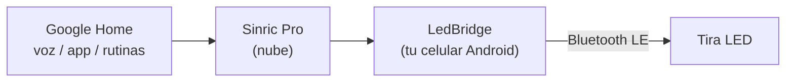

<p align="center">
  
</p>

<p align="center">
  <a href="https://github.com/bbernalm/LedBridge/releases/latest"></a>
  <a href="https://github.com/bbernalm/LedBridge/actions/workflows/build.yml"></a>
  
  <a href="LICENSE"></a>
</p>

<p align="center">
  <a href="README.md">English</a> · <b>Español</b>
</p>

---

**LedBridge** te permite controlar con **Google Home** y con la voz esas tiras LED Bluetooth baratas que solo funcionan con una app del celular, como *Lotus Lantern*: *"Ok Google, pon las luces en azul al 30 %"*. Solo necesitas un celular Android que ya tengas.

Google Home no puede hablar con dispositivos Bluetooth LE genéricos. Las soluciones habituales requieren una Raspberry Pi o un mini PC con Home Assistant o Homebridge, o cambiar el controlador de la tira por uno con Wi-Fi. LedBridge convierte tu celular en el puente.



## Características

- Encender, apagar, color, brillo y temperatura de color blanco desde Google Home (voz, app y rutinas).
- Funciona como servicio en primer plano, así que sigue activo con la pantalla apagada.
- Se reconecta solo a la tira y a la nube.
- Botones de prueba integrados (rojo, verde, azul, blanco, apagar) para comprobar el Bluetooth sin Google de por medio.
- Registro en pantalla que muestra cada orden recibida de Google, útil para resolver problemas.
- Código abierto (MIT). No lleva ninguna clave incluida: escribes tus propias credenciales de Sinric Pro en la app.

## Compatibilidad

| | |
|---|---|
| **Probado con** | Un controlador que se anuncia como `BLEDDM`, manejado con la app Lotus Lantern, en un Tecno Camon 30 |
| **Debería funcionar con** | Controladores de la familia ELK-BLEDOM: servicio GATT `FFF0` / característica `FFF3` (o `FFE0` / `FFE1`) y tramas de 9 bytes que empiezan en `7E` y terminan en `EF` |
| **No compatible** | Controladores que usan otro protocolo Bluetooth |
| **Celular** | Android 8.0 o superior |

¿No sabes si tu tira sirve? Instala **nRF Connect** (gratis), escanea y busca tu controlador: si expone el servicio `FFF0` o `FFE0`, hay buenas posibilidades de que funcione.

## Requisitos

- Un celular Android que se mantenga **encendido, con internet, con Bluetooth y a unos 5-8 m de la tira**. Si el celular se va, las luces dejan de responder a Google.
- Una cuenta gratis de [Sinric Pro](https://sinric.pro) (su plan gratuito indica 3 dispositivos).
- La app Google Home.

## Descarga

Descarga el último APK desde la [**página de Releases**](https://github.com/bbernalm/LedBridge/releases/latest), pásalo a tu celular y ábrelo (Android te pedirá permitir instalar desde el navegador o el administrador de archivos).

## Tutorial paso a paso

### 1. Crea la luz en Sinric Pro

1. Regístrate en [sinric.pro](https://sinric.pro) e inicia sesión.
2. Entra a **Devices → Add Device**.
3. Escribe un nombre (por ejemplo *Luces del cuarto*) y elige el tipo de dispositivo **Smart Light Bulb**. Deja tu App Key por defecto y guarda.
4. Anota tres datos:
   - **App Key** y **App Secret**: en **Credentials**.
   - **Device ID**: aparece junto a tu dispositivo en la lista de **Devices**.

### 2. Instala LedBridge en el celular

Descarga el APK desde [Releases](https://github.com/bbernalm/LedBridge/releases/latest) e instálalo.

### 3. Libera la tira de la app original

La tira acepta **una sola conexión Bluetooth a la vez**. Cierra Lotus Lantern por completo: **Ajustes → Apps → Lotus Lantern → Forzar detención**. Si más adelante sigue fallando, desenchufa el USB de la tira 10 segundos y vuelve a enchufarlo.

### 4. Configura e inicia el puente

Abre LedBridge y rellena los cuatro campos:

| Campo | Qué poner |
|---|---|
| Nombre Bluetooth | El nombre que anuncia tu tira (`BLEDDM` en la prueba). Si ves uno más largo, como `ELK-BLEDDM`, usa ese. |
| Sinric Pro · App Key | De **Credentials** |
| Sinric Pro · App Secret | De **Credentials** |
| Sinric Pro · Device ID | De la lista de **Devices** |

Pulsa **Guardar e iniciar** y acepta los permisos (*Dispositivos cercanos* y *Notificaciones*). La primera vez deja la pantalla encendida, porque Android bloquea los escaneos Bluetooth sin filtro mientras la pantalla está apagada. Tras la primera conexión se recuerda la dirección de la tira y se reconecta incluso con la pantalla apagada.

En unos segundos el estado debe decir:

```
Servicio: ACTIVO
Tira (Bluetooth): conectada ✔
Google Home (Sinric Pro): conectado ✔
```

Usa los botones **Rojo / Verde / Azul / Blanco / Apagar** para comprobar que la tira reacciona. Esto prueba solo el Bluetooth, sin Google.

### 5. Vincula Sinric Pro con Google Home

1. Abre la app **Google Home** y pulsa **+ → Dispositivo** (los nombres de los menús cambian un poco entre versiones).
2. Elige **Funciona con Google**.
3. Busca **Sinric Pro**, inicia sesión con tu cuenta de Sinric Pro y autoriza.
4. Tu luz aparece en Google Home. Pruébala: *"Ok Google, enciende las luces del cuarto"*, *"ponlas en azul"*, *"al 30 %"*.

### 6. Evita que el celular cierre la app

Los fabricantes son agresivos con las apps en segundo plano, y algunos (Tecno HiOS, Xiaomi, Huawei, Samsung...) cerrarán LedBridge a las pocas horas si no la exceptúas.

1. En LedBridge pulsa **Quitar ahorro de batería (importante)** y permite.
2. **Ajustes → Aplicaciones → LedBridge → Batería → Sin restricciones** (el texto varía según la marca).
3. Abre las apps recientes y **bloquea** LedBridge (candado o "mantener abierta"), y activa el *inicio automático* o *ejecutar en segundo plano* si tu celular tiene esa opción.

En [dontkillmyapp.com](https://dontkillmyapp.com) hay pasos específicos por marca. LedBridge no arranca sola tras reiniciar el celular: ábrela y pulsa **Guardar e iniciar** otra vez.

Para volver a usar Lotus Lantern, pulsa primero **Detener** en LedBridge.

## Solución de problemas

<details>
<summary><b>"No encontré la tira" / nunca conecta</b></summary>

Fuerza la detención de Lotus Lantern, desenchufa y vuelve a enchufar la tira, y deja la pantalla encendida. El registro lista cada dispositivo Bluetooth visto (`Visto: nombre (dirección)`), así que puedes comprobar el nombre exacto y escribirlo en el campo *Nombre Bluetooth*.
</details>

<details>
<summary><b>Conecta y desconecta (estado 133)</b></summary>

Casi siempre Lotus Lantern sigue ocupando la conexión. Fuerza su detención y espera 10 segundos.
</details>

<details>
<summary><b>"Sinric Pro desconectado: rechazado (401/403)"</b></summary>

La App Key o el Device ID están mal. Cópialos de nuevo sin espacios.
</details>

<details>
<summary><b>Sinric Pro conecta pero Google dice que el dispositivo no responde</b></summary>

La tira no está conectada por Bluetooth, o el App Secret está mal. El registro muestra `Respondí con error` cuando LedBridge tuvo que rechazar una orden.
</details>

<details>
<summary><b>Funciona un rato y luego deja de funcionar</b></summary>

El ahorro de batería del celular está cerrando la app. Repite el paso 6.
</details>

<details>
<summary><b>"App no instalada" al actualizar</b></summary>

Ya hay instalado un APK firmado con otra clave (por ejemplo uno que compilaste en Android Studio). Desinstálalo primero. Las versiones de Releases de este repo se firman todas con la misma clave, así que se actualizan entre sí sin problema.
</details>

## Compilar desde el código

**Android Studio:** abre la carpeta del proyecto, espera a que Gradle sincronice y pulsa **Run**. Necesitas JDK 17 y la plataforma Android SDK 35 (Android Studio te ofrece instalarlas).

**Línea de comandos:**

```bash
./gradlew assembleDebug
# APK: app/build/outputs/apk/debug/app-debug.apk
```

**Publicar una versión (mantenedores):** sube un tag que empiece por `v`. GitHub Actions compila el APK y lo adjunta a una nueva release.

```bash
git tag v1.0.1
git push origin v1.0.1
```

> **Nota de seguridad:** el APK se firma con la clave de depuración incluida en `app/debug.keystore`. Esa clave es pública a propósito, y por eso las actualizaciones funcionan, pero significa que la firma por sí sola no demuestra quién compiló un APK. Si eso te importa, compila desde el código.

## Cómo funciona

- **Lado Bluetooth.** La tira se controla con tramas ELK-BLEDOM escritas en la característica `FFF3` del servicio `FFF0` (o `FFE1` / `FFE0`):

  | Acción | Bytes (hex) |
  |---|---|
  | Encender | `7E 04 04 F0 00 01 FF 00 EF` |
  | Apagar | `7E 04 04 00 00 00 FF 00 EF` |
  | Color | `7E 07 05 03 RR GG BB 10 EF` |

  El brillo se aplica por software escalando los valores RGB, así funciona en todas las variantes del controlador.
- **Lado nube.** LedBridge abre un WebSocket a `wss://ws.sinric.pro`, recibe las órdenes de Google (`setPowerState`, `setBrightness`, `adjustBrightness`, `setColor`, `setColorTemperature`) y responde a cada una con un mensaje firmado con HMAC-SHA256 usando tu App Secret.
- **Mapa del código:** `BleLed.kt` (Bluetooth), `SinricClient.kt` (nube), `LightController.kt` (estado de la luz), `BridgeService.kt` (servicio en primer plano), `MainActivity.kt` (pantalla).

## Limitaciones conocidas

- El celular debe estar encendido y cerca de la tira, y la tira solo habla con una app a la vez.
- Por ahora la interfaz de la app está solo en español.
- No arranca sola tras reiniciar.
- Solo está implementado el protocolo tipo ELK-BLEDOM.

## Contribuir

Los issues y pull requests son bienvenidos. Buenas primeras contribuciones: traducir la interfaz (pasar los textos a recursos), soportar otros protocolos de controladores y el inicio automático tras reiniciar. Si tu tira funciona (o no), abre un issue con el nombre que anuncia para que la lista de compatibilidad crezca.

## Créditos y licencia

Publicado bajo la [licencia MIT](LICENSE). El ícono de la bombilla viene de los Material Icons de Google (Apache 2.0). LedBridge es un proyecto independiente y no está afiliado ni respaldado por Google, Sinric Pro ni los fabricantes de Lotus Lantern; todos los nombres de productos son marcas de sus respectivos dueños.
