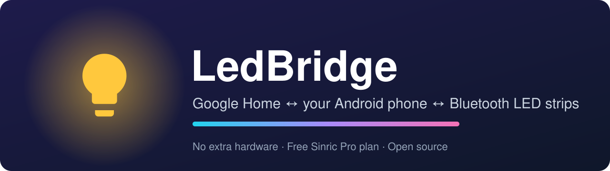
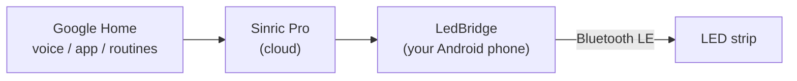

<p align="center">
  
</p>

<p align="center">
  <a href="https://github.com/bbernalm/LedBridge/releases/latest"></a>
  <a href="https://github.com/bbernalm/LedBridge/actions/workflows/build.yml"></a>
  
  <a href="LICENSE"></a>
</p>

<p align="center">
  <b>English</b> · <a href="README.es.md">Español</a>
</p>

---

**LedBridge** lets you control cheap Bluetooth LED strips, the kind that only work with a phone app such as *Lotus Lantern*, from **Google Home** and by voice: *"Hey Google, turn the lights blue at 30 %"*. All it needs is an Android phone you already own.

Google Home cannot talk to generic Bluetooth LE devices. The usual workarounds need a Raspberry Pi or a mini PC running Home Assistant or Homebridge, or swapping the strip's controller for a Wi-Fi one. LedBridge turns your phone into the bridge instead.



## Features

- On / off, color, brightness and white color temperature, all from Google Home (voice, app and routines).
- Runs as a foreground service, so it keeps working with the screen off.
- Reconnects automatically to the strip and to the cloud.
- Built-in test buttons (red, green, blue, white, off) to check Bluetooth without involving Google.
- On-screen log that shows every command received from Google, handy for troubleshooting.
- Open source (MIT). No keys are baked in: you type your own Sinric Pro credentials in the app.

## Compatibility

| | |
|---|---|
| **Tested with** | A controller advertising as `BLEDDM`, driven by the Lotus Lantern app, on a Tecno Camon 30 |
| **Should work with** | Controllers of the ELK-BLEDOM family: GATT service `FFF0` / characteristic `FFF3` (or `FFE0` / `FFE1`) and 9-byte frames that start with `7E` and end with `EF` |
| **Not supported** | Controllers that use a different Bluetooth protocol |
| **Phone** | Android 8.0 or newer |

Not sure whether your strip qualifies? Install **nRF Connect** (free), scan, and look for your controller: if it exposes service `FFF0` or `FFE0`, there is a good chance it works.

## Requirements

- An Android phone that stays **powered on, with internet, Bluetooth on and within about 5-8 m of the strip**. If the phone leaves, the lights stop responding to Google.
- A free [Sinric Pro](https://sinric.pro) account (its free plan lists 3 devices).
- The Google Home app.

## Download

Grab the latest APK from the [**Releases page**](https://github.com/bbernalm/LedBridge/releases/latest), copy it to your phone and open it (Android will ask you to allow installs from your browser or file manager).

> The app screen is currently in Spanish. The tutorial below gives the English meaning of every button.

## Step-by-step setup

### 1. Create the light in Sinric Pro

1. Sign up at [sinric.pro](https://sinric.pro) and log in.
2. Go to **Devices → Add Device**.
3. Enter a name (for example *Bedroom lights*) and choose the device type **Smart Light Bulb**. Keep your default App Key and save.
4. Write down three values:
   - **App Key** and **App Secret**: under **Credentials**.
   - **Device ID**: shown for your device in the **Devices** list.

### 2. Install LedBridge on your phone

Download the APK from [Releases](https://github.com/bbernalm/LedBridge/releases/latest) and install it.

### 3. Free the strip from the original app

The strip accepts **one Bluetooth connection at a time**. Close Lotus Lantern completely: **Settings → Apps → Lotus Lantern → Force stop**. If it keeps failing later, unplug the strip's USB for 10 seconds and plug it back in.

### 4. Configure and start the bridge

Open LedBridge and fill in the four fields:

| Field | What to enter |
|---|---|
| Bluetooth name | The name your strip advertises (`BLEDDM` in the tested setup). If you see a longer one such as `ELK-BLEDDM`, use that. |
| Sinric Pro App Key | From **Credentials** |
| Sinric Pro App Secret | From **Credentials** |
| Sinric Pro Device ID | From the **Devices** list |

Tap **Guardar e iniciar** (*Save and start*) and accept the permissions (*Nearby devices* and *Notifications*). Keep the screen on the first time, because Android blocks unfiltered Bluetooth scans while the screen is off. After the first connection the strip's address is remembered and reconnecting works with the screen off.

Within a few seconds the status should read:

```
Servicio: ACTIVO
Tira (Bluetooth): conectada ✔
Google Home (Sinric Pro): conectado ✔
```

Use the **Rojo / Verde / Azul / Blanco / Apagar** (*Red / Green / Blue / White / Off*) buttons to confirm the strip reacts. This tests Bluetooth only, with no Google involved.

### 5. Link Sinric Pro to Google Home

1. Open the **Google Home** app and tap **+ → Device** (menu names change a little between app versions).
2. Choose **Works with Google**.
3. Search for **Sinric Pro**, sign in with your Sinric Pro account and authorize.
4. Your light appears in Google Home. Try it: *"Hey Google, turn on the bedroom lights"*, *"make them blue"*, *"set them to 30 %"*.

### 6. Stop the phone from killing the app

Phone makers are aggressive with background apps, and some (Tecno HiOS, Xiaomi, Huawei, Samsung...) will end LedBridge after a few hours unless you exempt it.

1. In LedBridge tap **Quitar ahorro de batería (importante)** (*Remove battery saving*) and allow it.
2. **Settings → Apps → LedBridge → Battery → Unrestricted** (wording varies by brand).
3. Open the recent apps screen and **lock** LedBridge (padlock icon or "keep open"), and enable *auto-start* / *run in background* for it if your phone has that option.

See [dontkillmyapp.com](https://dontkillmyapp.com) for brand-specific steps. LedBridge does not start by itself after a reboot: open it and tap **Guardar e iniciar** again.

To use Lotus Lantern again, tap **Detener** (*Stop*) in LedBridge first.

## Troubleshooting

<details>
<summary><b>"Could not find the strip" / it never connects</b></summary>

Force stop Lotus Lantern, unplug and re-plug the strip, and keep the screen on. The log lists every Bluetooth device seen (`Visto: name (address)`), so you can check the exact name and type it in the *Bluetooth name* field.
</details>

<details>
<summary><b>It connects and disconnects (status 133)</b></summary>

Almost always Lotus Lantern is still holding the connection. Force stop it and wait 10 seconds.
</details>

<details>
<summary><b>"Sinric Pro disconnected: rejected (401/403)"</b></summary>

The App Key or Device ID is wrong. Copy them again without spaces.
</details>

<details>
<summary><b>Sinric Pro is connected but Google says the device is not responding</b></summary>

The strip is not connected over Bluetooth, or the App Secret is wrong. The log shows `Respondí con error` (*I answered with an error*) when LedBridge had to refuse a command.
</details>

<details>
<summary><b>It works for a while and then stops</b></summary>

Your phone's battery saver is closing the app. Repeat step 6.
</details>

<details>
<summary><b>"App not installed" when updating</b></summary>

An APK signed with a different key is already installed (for example one you built in Android Studio). Uninstall it first. Releases built by this repo are all signed with the same key, so updates between them install normally.
</details>

## Build from source

**Android Studio:** open the project folder, let Gradle sync, and press **Run**. You need JDK 17 and the Android SDK 35 platform (Android Studio offers to install them).

**Command line:**

```bash
./gradlew assembleDebug
# APK: app/build/outputs/apk/debug/app-debug.apk
```

**Publishing a release (maintainers):** push a tag that starts with `v`. GitHub Actions builds the APK and attaches it to a new release.

```bash
git tag v1.0.1
git push origin v1.0.1
```

> **Security note:** the APK is signed with the debug key committed in `app/debug.keystore`. That key is public on purpose, which makes updates work, but it means the signature alone does not prove who built an APK. Build from source if that matters to you.

## How it works

- **Bluetooth side.** The strip is controlled with ELK-BLEDOM frames written to characteristic `FFF3` of service `FFF0` (or `FFE1` / `FFE0`):

  | Action | Bytes (hex) |
  |---|---|
  | Power on | `7E 04 04 F0 00 01 FF 00 EF` |
  | Power off | `7E 04 04 00 00 00 FF 00 EF` |
  | Color | `7E 07 05 03 RR GG BB 10 EF` |

  Brightness is applied in software by scaling the RGB values, so it works on every controller variant.
- **Cloud side.** LedBridge opens a WebSocket to `wss://ws.sinric.pro`, receives Google's commands (`setPowerState`, `setBrightness`, `adjustBrightness`, `setColor`, `setColorTemperature`) and answers each one with a message signed with HMAC-SHA256 using your App Secret.
- **Code map:** `BleLed.kt` (Bluetooth), `SinricClient.kt` (cloud), `LightController.kt` (light state), `BridgeService.kt` (foreground service), `MainActivity.kt` (screen).

## Known limitations

- The phone must stay on and near the strip, and the strip only talks to one app at a time.
- The app interface is in Spanish only for now.
- No auto-start after reboot.
- Only the ELK-BLEDOM-style protocol is implemented.

## Contributing

Issues and pull requests are welcome. Good first contributions: translating the interface (moving strings to resources), supporting other controller protocols, and auto-start after boot. If your strip works (or doesn't), please open an issue with the name it advertises so the compatibility list can grow.

## Credits and license

Released under the [MIT license](LICENSE). The light bulb icon comes from Google's Material Icons (Apache 2.0). LedBridge is an independent project and is not affiliated with or endorsed by Google, Sinric Pro or the makers of Lotus Lantern; all product names are trademarks of their respective owners.
